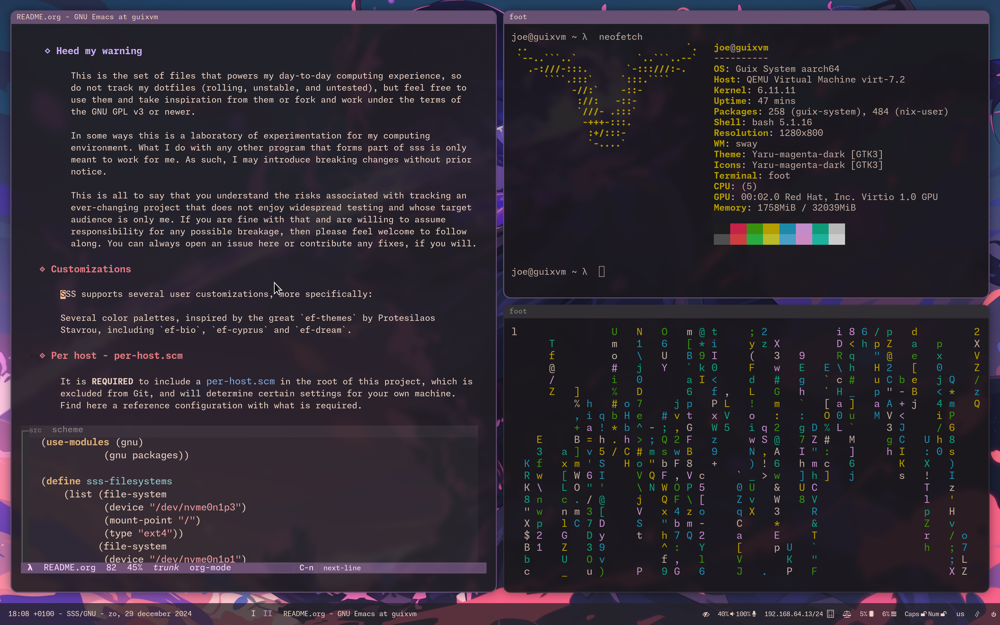

#+title: Supreme Sexp System - SSS
#+author: Josep Bigorra
#+email: jjbigorra@gmail.com
#+options: num:nil

SSS is a Lisp machine adventure, where the hacking culture is celebrated. Let me help you achieve /GNUrvana/.

If you like my work, please support me by [[https://bmc.link/jjbigorra][buying me a cup of coffee ☕]] so I can continue with a lot of motivation.

This custom GNU + Linux setup enhances customization to infinity, encourages the hacking spirit, and offers a superior user experience thanks in part too to REPL (Read Eval Print Loop) and Lisps.

Installing and managing SSS is not intended for beginners to GNU/Linux systems, and requires some prior experience in this. Familiarity with Lisp dialects is also a great plus point.

SSS strives to have all things configured via Lisp dialects when possible and convenient, staying accessible to all kinds of users, and allowing for magical things to happen.

I would appreciate if you write your findings when using SSS and if you can, fork the project, and contribute some improvements, or mail me at <jjbigorra@gmail.com>

It is recommended to use tagged releases of SSS, as those are considered as stable by the developers.

Note: Screenshot below might be outdated and no longer representative of the current, ever-changing state of SSS.

** SSS Manuals

I strive to provide proper and extensive documentation on the Supreme Sexp System (SSS), in several formats, available at your convenience.

- Org format [[file:docs/Manual/README.org]]
- Online HTML: [[https://jointhefreeworld.org/manuals/sss/index.html]] 
- PDF format [[file:docs/Manual/README.pdf]]  
- HTML format [[file:docs/Manual/README.html]]
- Markdown format [[file:docs/Manual/README.md]]  
- texi format [[file:docs/Manual/README.texi]]
- info format [[file:docs/Manual/README.info]]    

** What lies here?

*** An operating system (OS) configured in Scheme

- GNU Guix system configurations
- SwayFX configurations
- Foot terminal emulator
- Rofi application launcher
- Waybar configuration and style
- Mako configuration and style
- multi-user Git configuration setup (work/personal)
- Qutebrowser configurations
- Multi user configurations
- Theme palettes that affect the entire system
  
*** Joe's Emacs configuration

An operating system unto itself.

- Advanced Emacs configurations with Emacs Lisp + Elpaca
- Dev setup for: Scheme, Scala, Haskell, Lisp, Python, Shell, Nix and more

* SSS Project

Contributing to free software is a uniquely beautiful act because it embodies principles of generosity, collaboration, and empowerment.

We welcome everyone to feel invited to the SSS Project, and feel free to contribute, improve it and/or suggest improvements, brainstorm with me, make it more modular/flexible.

Find the backlog and [[file:../project-management.org][project management of SSS here]].
