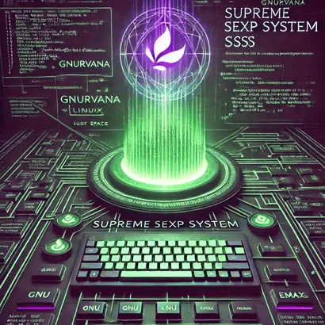
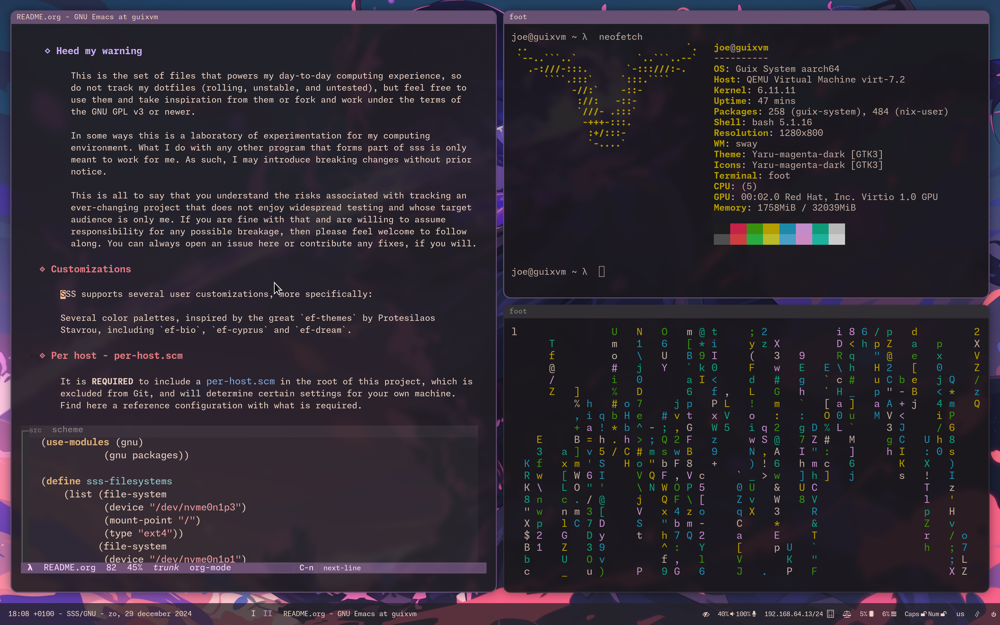

# Table of Contents

1.  [What lies here?](#org81752b9)
    1.  [An operating system (OS) configured in Scheme](#org21fadba)
    2.  [Joe's Emacs configuration](#org40fead5)
2.  [Why ?](#org0a6dbfb)
3.  [What is Guix](#org8a6817d)
4.  [On Non-free software](#org0d2ee4c)
5.  [Keyboard Terminology](#orgdd47aca)
6.  [How this manual works](#orgd7d2fbc)
7.  [Customizing SSS](#org0828d00)
8.  [Per host - per-host.scm](#orgf11a1f7)
9.  [Bootstrapping](#org72b279a)
    1.  [Guix Install tips](#org399242f)
    2.  [Installing SSS on Guix](#org1c7f5f2)
        1.  [Adding channels](#orgbf61ae3)
        2.  [Keeping SSS updated](#org06c881d)
        3.  [Initial installation of SSS from a devshell](#org37e5703)
    3.  [On login managers, and login screens](#org87f52a4)
10. [Nix profile](#orge11e2c0)
11. [SSS Project](#org23d5688)
12. [System audio](#org5652608)
13. [Sway, resolutions and scaling](#orgbbf9bd4)
14. [Wallpapers](#org02ef5a8)
15. [SSH, Git](#org9f9607d)
16. [Disk space](#orgf7f81fc)
17. [Bluetooth](#org0f521a2)
18. [Sway keybindings](#org42340cb)
    1.  [General keybindings](#org2fb50b9)
    2.  [Application keybindings](#org01d99ce)
    3.  [More keybindings](#org09d9640)
19. [Emacs keybindings](#org9b38d35)
    1.  [General non-vanilla bindings](#org17bd7b6)
    2.  [SSS specific keybindings](#orga56a7a9)
20. [Glossary](#org46d0712)
21. [Acronyms](#orgd9a531c)

You are reading the manual for the Supreme Sexp System (SSS).

This manual documents the SSS/GNU system and its functionalities.

SSS is a Lisp machine adventure, where the hacking culture is celebrated. Let me help you achieve *GNUrvana*.

If you like my work, please support me by [buying me a cup of coffee](https://bmc.link/jjbigorra) so I can continue with a lot of motivation.

This custom GNU + Linux setup lets you customize everything endlessly, inspires creativity and problem-solving, and gives you a great user experience. This is partly thanks to the REPL (Read Eval Print Loop) and Lisp programming languages.

Installing and managing SSS is not meant for people new to GNU/Linux systems. You should already have some experience using them. Knowing Lisp dialects is also a big help.

SSS tries to set up everything using Lisp dialects whenever it makes sense and is easy to do. This keeps it user-friendly and lets you do some amazing things.

I would appreciate if you write your findings when using SSS and if you can, fork the project, and contribute some improvements, or mail me at <jjbigorra@gmail.com>

It is recommended to use tagged releases of SSS, as those are considered as stable by the developers.

Note: Screenshot below might be outdated and no longer representative of the current, ever-changing state of SSS.

# What lies here?

## An operating system (OS) configured in Scheme

-   GNU Guix system configurations
-   SwayFX configurations
-   Foot terminal emulator
-   Rofi application launcher
-   Waybar configuration and style
-   Mako configuration and style
-   multi-user Git configuration setup (work/personal)
-   Qutebrowser configurations
-   Multi user configurations
-   Theme palettes that affect the entire system

## Joe's Emacs configuration

An operating system unto itself.

-   Advanced Emacs configurations with Emacs Lisp + Elpaca

# Why ?

Find the divine sayings, and the destined computer configurations, all my Guix, Scheme, SwayFX, and Emacs Lisp and more configurations here for learning you a fully Lisp machine with GNU/Linux for a great good.

Warning: parts of the code and settings might default to the Dutch language ( `nl_NL.UTF-8` ).

I am currently working on the GNU operating system in order to create a secure libre Lisp workstation.

I refer to SSS lovingly as the modern Lisp machine. With this one obtains a computing style and programming environment that can be referred to as Lisp user space. This is a modern iteration of the Lisp machines of yore.

You can be aware of all the code that is running on your machine, which puts free GNU systems among the most secure operating systems on Earth.

Learning Lisps is really going down a rabbit hole, but trust me, you will come out with a better understanding of programming as a whole out the other end.

Lisp user space provides an introspective, hackable, and transactionable operating system that can be modified live in a REPL.

The lines between data and code fade, allowing insane flexibility and power.

Lisp user space is centered on accessible interfaces that are mostly text-based, and can be mostly used without a mouse, which makes it easier to use for people living with disabilities as well as power users.

All of the system can be inspected and most of it can be hacked live in a REPL, making it a pure expression of the libre software ethic, and an incredibly versatile tool for a skilled programmer.

In some ways this is a laboratory of experimentation for my computing environment. What I do with any other program that forms part of SSS is only meant to work for me. As such, I will try to maintain backwards compatibility and consistency, but I may introduce breaking changes without prior notice.

This configuration is somewhat biased towards containing a `joe` user who also acts as administrator for most of the time. This is trivial to change and should be easy to adapt to your needs. Your mileage may vary (YMMV).

Some commands in the `Makefile` are more geared towards `joe` since we assume a device is most frequently only tended to by one system administration most of the time. Some examples are `make fr` or `make jr`. Feel free to change this or contribute improvements to make this modular.

The system and home folders of users are managed independently of each other, in quite a loosely coupled manner.

# What is Guix

GNU Guix is a package management tool for and distribution of the GNU system. Guix makes reproducibility easy and allows users to install, upgrade, or remove software packages, to roll back to a previous package set, to build packages from source, and generally assists with the creation and maintenance of software environments.

While you can install GNU Guix on top of an existing GNU/Linux system where it complements the available tools without interference, I encourage the use of Guix system, as standalone operating system distro, on top of which I have built the Supreme Sexp System (SSS).

I highly recommend refering to and studying the Guix reference manual, it's a super valuable source of knowledge: <https://guix.gnu.org/manual/en/html_node/>.

# On Non-free software

SSS attempts to stay as libre as possible, while also respecting your convenience.

This means, among other things that SSS:

-   includes the OG Linux kernel (with proprietary blobs) so as to be more compatible with modern hardware
-   includes non-guix software channel by default, so as to allow installation of convenient software to which few/no libre alternatives exist.

# Keyboard Terminology

When keybindings (shortcurts) are defined, the following legend applies (a la Emacs):

<table border="2" cellspacing="0" cellpadding="6" rules="groups" frame="hsides">

<colgroup>
<col  class="org-left" />

<col  class="org-left" />
</colgroup>
<thead>
<tr>
<th scope="col" class="org-left">term</th>
<th scope="col" class="org-left">meaning</th>
</tr>
</thead>

<tbody>
<tr>
<td class="org-left"><code>s</code></td>
<td class="org-left">Super / Windows / CMD key</td>
</tr>

<tr>
<td class="org-left"><code>S</code></td>
<td class="org-left">Shift key</td>
</tr>

<tr>
<td class="org-left"><code>M</code></td>
<td class="org-left">Meta / Alt / Option key</td>
</tr>

<tr>
<td class="org-left"><code>C</code></td>
<td class="org-left">Control key</td>
</tr>

<tr>
<td class="org-left"><code>SPC</code></td>
<td class="org-left">Space key</td>
</tr>
</tbody>
</table>

# How this manual works

This manual is written by hand with care and attention for detail.

I write my documents in Org format from Emacs and export them for your convenience to several other formats. A usual release of the manual happens as follows:

-   Edit the SSS manual
-   Run `C-c # m` from Emacs, which runs lib/sss-manual.el, exporting the Org document to several other formats (LaTEX, PDF, HTML, Markdown, etc.)

# Customizing SSS

SSS supports several user customizations, more specifically:

Several color palettes, inspired by the great \`ef-themes\` by Protesilaos Stavrou, including `ef-bio`, `ef-cyprus` and `ef-dream`.

Find Prot's themes here: <https://github.com/protesilaos/ef-themes>

# Per host - per-host.scm

It is **REQUIRED** to include a `per-host.scm` in the root of this project, which is excluded from Git, and will determine certain settings for your own machine.
Find here a reference configuration with what is required.

    (use-modules (gnu)
                 (gnu packages))
    
    ;; system language
    (define sss-lang "en_US")
    
    ;; system timezone
    (define sss-timezone "Europe/Amsterdam")
    
    ;; system keyboard layout
    (define sss-keyboard-layout "us")
    
    ;; caps to control enabled
    (define sss-keyboard-caps-to-ctrl
      #t)
    
    ;; system hostname
    (define sss-hostname "gnusystem")
    
    ;; disk partitioning
    (define sss-filesystems
      (list (file-system
             (device "/dev/nvme0n1p3")
             (mount-point "/")
             (type "ext4"))
            (file-system
             (device "/dev/nvme0n1p1")
             (mount-point "/boot/efi")
             (type "vfat"))))
    
    ;; packages that should only be installed in the current host
    ;; or (define sss-per-host-packages '())
    (define sss-per-host-packages
      (list
       ;; AMD non-free drivers
       (specification->package "amd-microcode")
       (specification->package "amdgpu-firmware")
       ;; Games
       (specification->package "prismlauncher")
       (specification->package "steam")))
    
    ;; location where you cloned SSS Git repository
    (define sss-clone-dir
      "/home/joe/Ontwikkeling/Persoonlijk/sss")
    
    ;;
    ;; Define the active palette for all users accounts
    ;; You should reconfigure and ideally restart the system
    ;; for all changes to take effect
    ;;
    ;; Note: You could choose on a per-user basis to set a fixed palette
    ;; and not follow system wide, by just redefining this value
    ;;
    ;; Possible values are:
    ;;   - sss-palette-ef-bio
    ;;   - sss-palette-ef-cyprus
    ;;   - sss-palette-ef-dream
    ;;
    (define-public sss-active-palette
      'sss-palette-ef-dream)

# Bootstrapping

It's possible you need to some manual installations, and temporary workarounds, in order to install `sss` on a brand-new Guix installation.

Some aspects will be dependent on the manner of installation and hardware. Below follows a simple startup guide.

Download and the Guix GNU/Linux distribution from the official Guix page: <https://guix.gnu.org/download/> and make a bootable installation medium convenient for your use case.

If you are not familiar with the `dd` command which is present in all GNU/Linux distributions and in macOS, you can always feel free to use something like Rufus on Windows, or balenaEtcher, to flash this image into a USB, with which you can then boot your computer.

It is highly recommended to first become familiar with SSS and Guix via a *throw-away* virtual machine where you can experiment and do mistakes. After familiarity is acquired then a bare metal installation is the best.

SSS strives to be completely cross-architecture and should work well everywhere. That being said, as of the latest manual, x86-64 is the preferred architecture.

## Guix Install tips

If your system doesn't boot due to lack of drivers, it can be useful to add the `nomodeset` option after `quiet` in the GRUB menu, by editing the boot "command" of the latest entry.

If you are on aarch64/arm64, or other more niche architectures, then you might need to put in some more work to get an installer image, and to get it working, likely having to generate an ISO image yourself to install Guix or a qcow2 virtual machine.

The following articles may be of help:
<https://jointhefreeworld.org/blog/articles/gnu-linux/gnu-guix-virtual-machine-image-aarch64/>

If things really aren't working with your hardware, you can build your own ISO with the right drivers, or use the one from nonguix: <https://gitlab.com/nonguix/nonguix/-/releases>

It is highly recommended to connect your device to Internet via an Ethernet cable or some other form of wired connection, specially since Guix by default will only come with free software drivers, and as such, might not immediately support your WiFi card. After installing SSS drivers will be there and you can use WiFi.

When installing Guix, make sure you take note of the Scheme code that gets generated by it, specially for the disk partitioning. You will see this at the last install step. This code can also be found after installing, at `/etc/config.scm` by default. Parts of this code will later need to be added to the `per-host.scm`.

After having installed things using the guided Guix installer, or via the command line for advanced users, boot into your new system.

I would recommend to then use a web browser and visit the web version of this manual: <https://codeberg.org/jjba23/sss/src/branch/trunk/docs/Manual>.

## Installing SSS on Guix

Once you have a working Guix base installation on your machine, you are ready to go about installing SSS.

### Adding channels

Add `nonguix` in your channels file (`$HOME/.config/guix/channels.scm`). This will later be overwritten by SSS.

    (cons* (channel
          (name 'nonguix)
          (url "https://gitlab.com/nonguix/nonguix")
          (introduction
           (make-channel-introduction
            "897c1a470da759236cc11798f4e0a5f7d4d59fbc"
            (openpgp-fingerprint
             "2A39 3FFF 68F4 EF7A 3D29 12AF 6F51 20A0 22FB B2D5"))))
         %default-channels)

After adding the channel, perform a `guix pull` from your user account (**no sudo or root**) and let all channels get updated.

### Keeping SSS updated

You should every now and then update the SSS repo with `git pull`. You also should regularly do a `guix pull` from your regular user, and then rebuild this system with the root user (`make sr`).

Guix is a rolling distribution and you don't need to be always on bleeding edge releases, but it's nice to stay updated.

### Initial installation of SSS from a devshell

Once you have followed all those above steps, you can enter a temporary Guix shell, so as to bootstrap SSS.

You can do this with `guix shell make git icecat`. Icecat will be used for you to browse temporarily and install SSS.

Then proceed to clone SSS with `git clone https://codeberg.org/jjba23/sss.git` to your favourite location. This location will need to be added to `per-host.scm`.

You should have by now written an appropriate `per-host.scm` for your setup. See the above section on this topic.

Enter the directory of SSS: `cd sss`.

Make sure you place your `per-host.scm` in the root of this directory. Then you can do a `make sr`.

Note: `make sr` translates to `sudo guix system reconfigure config.scm --fallback`.

For more commands take a look at the SSS Makefile: <../../Makefile>.

The `fallback` option is optional, and simply helps when upstream substitute (cache) servers are less available.

Once the system reconfigure is complete, you should also bootstrap your user's GNU home with something like: `guix home reconfigure ./home/joe.scm  --fallback`

You might at this point want to reset the font cache for the system and user.

    fc-cache -frv
    sudo fc-cache -frv

You can then reboot and you should be greeted by a simple TTY.

## On login managers, and login screens

SSS uses **no login managers** like GDM or SDDM. Simply login to the TTY and start your favorite GUI (or not).
That being said, feel free to use your own.

I like to alias my login command to `gui`, or sometimes I directly run `sway` from the TTY.

Sometimes for the fun I work in Emacs from the TTY for that 60's and 70's computer vibe.

If you run traditional X11 sessions, you could choose to do startx instead of a Wayland session, but SSS is more geared to Wayland.

# Nix profile

Nixpkgs contains a lot of software which we can leverage and manage from Guix.

SSS will automatically install and provide the Nix package manager for you.

SSS also provides some facilities to manage Nix from the comfort of your Guile Scheme.

You might need to activate and link the profile in order to be able to use, for the first time.

Assuming `joe` as user in question.

`/nix/var/nix/profiles/per-user/` should be:

    joe@guixvm ~ λ  ll /nix/var/nix/profiles/per-user/
    
    drwxr-xr-x 2 joe  users  16K 29 dec 23:09 joe/
    drwxr-xr-x 2 root root  4,0K 22 nov 13:23 root/

For this, make the directory an link it to your home.

    sudo mkdir -p /nix/var/nix/profiles/per-user/joe
    sudo chown -R joe:users /nix/var/nix/profiles/per-user/joe
    ln -sfv /nix/var/nix/profiles/per-user/joe/profile /home/joe/.nix-profile

It's possible you might need to logout and log back in to re-activate the profile.

You can switch your install to use nixpkgs-unstable with:

    nix-channel --add https://nixos.org/channels/nixpkgs-unstable
    nix-channel --update

You can install Nix packages by running:

    nix -L profile install --impure nixpkgs#firefox

You can keep your Nix packages updated by running:

    NIXPGS_ALLOW_UNFREE=1 nix profile upgrade --impure '.*'

The installed software will be available, for example at: `/home/joe/.nix-profile/bin/`

SSS provides some scripts that allow you to maintain your Nix configuration and installed packages programatically, see the Makefile.

You will then need a file `system/nix-packages.scm`. You can find these scripts and the list file at `system/scripts` in this repo.
Installing all wanted Nix packages can be done with `make npi` for example and updating them with `make npu`.

      ;; Nix packages to install
    (define-public sss-nixpkgs '("yaml-language-server"
                                 "bash-language-server"
    
                                 "mermaid-cli"
                                 "jetbrains.idea-community"
                                 ))

# SSS Project

Find the [project management of SSS here](../Project management/README.md)

# System audio

SSS favors modern technologies and thus makes use of Pipewire for all your GNU/Linux audio needs.

In practice this means that any user account in your system that wants to make use of audio, should have the  `(service home-dbus-service-type)` and `(service home-pipewire-service-type)` services enabled for their account (yes per-user basis).

You will also want to set the `RTC_USE_PIPEWIRE` variable to `true`. This is already the case by default in SSS.

# Sway, resolutions and scaling

Most of the times, Sway will have set the correct resolution and scale (fractional) for your device. This also happens automatically when plugging in/out external monitors.

You might want to customize things though, here follow some examples of commands I use daily for this:

    # Set fractional scaling to 1.5x , perfect for my Framework laptop 13,5"
    swaymsg -- output eDP-1 scale 1.5
    # Set resolution to 4k and scale 2x
    swaymsg -- output Virtual-1 mode --custom 3840x2160 scale 2
    # Set resolution and refresh rate
    swaymsg -- output HDMI-A-1 mode --custom 1680x1050@50
    # 1080p
    swaymsg -- output Virtual-1 mode --custom 1920x1080 scale 1

# Wallpapers

SSS automatically loads at startup a matching wallpaper for the currently enabled theme.

This uses swww and thus can load animated images as well and do fancy transitions. If you have bugs loading wallpaper at startup, try reloading the wallpaper with `s-S-b`.

TODO: allow more dynamics and often changing of wallpapers, also random wallpaper script (but within theme)

# SSH, Git

SSS is automatically configured with SSH setup, and multi-user Git setup.

# Disk space

Reproducibility and isolation of builds naturally leads to a little more disk usage than other systems. This is not a problem nowadays, with cheap storage.

That being said, here follow some useful reminders, every now and then clean:

-   Guix generations
-   Guix store
-   Nix store
-   Unused Steam games

You could run something like this:

    sudo guix system delete-generations 1d
    sudo guix gc
    nix-store --gc

If you'd like to find the largest files in your disk, here’s an example command:  

    du -ah / | sort -rh | head -n 20

# Bluetooth

The real best way to manage your bluetooth is using the bluetoothctl shell. This is a little more manual and low-level, but it will allow your to programatically connect to your devices, setup shortcuts for "favourite" connections, and much more.

    # Run bluetoothctl in a shell
    user@host $ bluetoothctl
    #
    # Waiting to connect to bluetoothd...[bluetooth]# Agent registered
    # [bluetooth]# hci0 new_settings: powered bondable ssp br/edr le secure-conn cis-central cis-peripheral 
    # [bluetooth]# [CHG] Controller C8:A3:E8:76:98:80 Pairable: yes
    # [bluetooth]# AdvertisementMonitor path registered
    # [bluetooth]#
    
    #  help
    
    # then turn your bluethooth on:
    #  power on
    #
    # [bluetooth]# Changing power on succeeded
    
    # scan for devices around you:
    #  scan on
    #
    # [bluetooth]# SetDiscoveryFilter success
    # [bluetooth]# Discovery started
    # [bluetooth]# [CHG] Controller C8:A3:E8:76:98:80 Discovering: yes
    # [bluetooth]# [NEW] Device 52:B7:C5:C2:54:3A 52-B7-C5-C2-54-3A
    # [bluetooth]# [NEW] Device 4B:C8:1D:17:55:A6 4B-C8-1D-17-55-A6
    # [bluetooth]# [NEW] Device 27:9F:3F:70:13:71 27-9F-3F-70-13-71
    # [bluetooth]# [NEW] Device E3:FE:C8:39:99:36 Wahoo KICKR 6F8D
    
    # pair C0:23:8D:57:73:CF 
    
    # exit

# Sway keybindings

## General keybindings

<table border="2" cellspacing="0" cellpadding="6" rules="groups" frame="hsides">

<colgroup>
<col  class="org-left" />

<col  class="org-left" />
</colgroup>
<thead>
<tr>
<th scope="col" class="org-left">keybind</th>
<th scope="col" class="org-left">command</th>
</tr>
</thead>

<tbody>
<tr>
<td class="org-left"><code>s-k</code></td>
<td class="org-left">Kill/Close a window or application</td>
</tr>

<tr>
<td class="org-left"><code>s-S-c</code></td>
<td class="org-left">Reload Sway configuration</td>
</tr>

<tr>
<td class="org-left"><code>s-l</code></td>
<td class="org-left">Lock screen</td>
</tr>

<tr>
<td class="org-left"><code>s-1..9</code></td>
<td class="org-left">Move focus to workspace 1..9</td>
</tr>

<tr>
<td class="org-left"><code>s-S-1..9</code></td>
<td class="org-left">Move window to workspace 1..9</td>
</tr>

<tr>
<td class="org-left"><code>s-v</code></td>
<td class="org-left">Vertical splits</td>
</tr>

<tr>
<td class="org-left"><code>s-h</code></td>
<td class="org-left">Horizontal splits</td>
</tr>

<tr>
<td class="org-left"><code>s-S-SPC</code></td>
<td class="org-left">Toggle floating/tiling mode for window</td>
</tr>

<tr>
<td class="org-left">&#xa0;</td>
<td class="org-left">&#xa0;</td>
</tr>
</tbody>
</table>

## Application keybindings

<table border="2" cellspacing="0" cellpadding="6" rules="groups" frame="hsides">

<colgroup>
<col  class="org-left" />

<col  class="org-left" />
</colgroup>
<thead>
<tr>
<th scope="col" class="org-left">keybind</th>
<th scope="col" class="org-left">command</th>
</tr>
</thead>

<tbody>
<tr>
<td class="org-left"><code>s-/</code></td>
<td class="org-left">Launch application fuzzy finder menu (Rofi)</td>
</tr>

<tr>
<td class="org-left"><code>s-i</code></td>
<td class="org-left">Open a Web Browser (Qutebrowser)</td>
</tr>

<tr>
<td class="org-left"><code>s-S-i</code></td>
<td class="org-left">Open a bloated Web Browser (Chrome)</td>
</tr>

<tr>
<td class="org-left"><code>s-RET</code></td>
<td class="org-left">Open a terminal emulator (Foot)</td>
</tr>

<tr>
<td class="org-left"><code>s-t</code></td>
<td class="org-left"><i>idem</i></td>
</tr>

<tr>
<td class="org-left"><code>s-e</code></td>
<td class="org-left">Open text editor (Emacs)</td>
</tr>

<tr>
<td class="org-left"><code>s--</code></td>
<td class="org-left">Open password manager (1password)</td>
</tr>

<tr>
<td class="org-left">&#xa0;</td>
<td class="org-left">&#xa0;</td>
</tr>
</tbody>
</table>

## More keybindings

<table border="2" cellspacing="0" cellpadding="6" rules="groups" frame="hsides">

<colgroup>
<col  class="org-left" />

<col  class="org-left" />
</colgroup>
<thead>
<tr>
<th scope="col" class="org-left">keybind</th>
<th scope="col" class="org-left">command</th>
</tr>
</thead>

<tbody>
<tr>
<td class="org-left"><code>s-S-.</code></td>
<td class="org-left"><b>Copy</b> screenshot of entire screen</td>
</tr>

<tr>
<td class="org-left"><code>s-.</code></td>
<td class="org-left"><b>Save</b> screenshot of entire screen</td>
</tr>

<tr>
<td class="org-left"><code>s-S-b</code></td>
<td class="org-left">Set wallpaper to theme's default</td>
</tr>

<tr>
<td class="org-left">&#xa0;</td>
<td class="org-left">&#xa0;</td>
</tr>
</tbody>
</table>

# Emacs keybindings

## General non-vanilla bindings

<table border="2" cellspacing="0" cellpadding="6" rules="groups" frame="hsides">

<colgroup>
<col  class="org-left" />

<col  class="org-left" />
</colgroup>
<thead>
<tr>
<th scope="col" class="org-left">keybind</th>
<th scope="col" class="org-left">command</th>
</tr>
</thead>

<tbody>
<tr>
<td class="org-left"><code>M-s r</code></td>
<td class="org-left">consult-ripgrep</td>
</tr>

<tr>
<td class="org-left"><code>M-s o</code></td>
<td class="org-left">consult-occur</td>
</tr>

<tr>
<td class="org-left">&#xa0;</td>
<td class="org-left">&#xa0;</td>
</tr>
</tbody>
</table>

## SSS specific keybindings

<table border="2" cellspacing="0" cellpadding="6" rules="groups" frame="hsides">

<colgroup>
<col  class="org-left" />

<col  class="org-left" />
</colgroup>
<thead>
<tr>
<th scope="col" class="org-left">keybind</th>
<th scope="col" class="org-left">command</th>
</tr>
</thead>

<tbody>
<tr>
<td class="org-left"><code>C-c # s</code></td>
<td class="org-left">Perform a system rebuild</td>
</tr>

<tr>
<td class="org-left"><code>C-c # j</code></td>
<td class="org-left">Perform a joe rebuild</td>
</tr>

<tr>
<td class="org-left"><code>C-c # f</code></td>
<td class="org-left">Perform a system + joe rebuild</td>
</tr>

<tr>
<td class="org-left">&#xa0;</td>
<td class="org-left">&#xa0;</td>
</tr>
</tbody>
</table>

# Glossary

-   ****GNU/Linux****: A free and open-source operating system combining the GNU system and the Linux kernel.
-   ****Lisp Machine****: A type of computer optimized for running Lisp, a family of programming languages.
-   ****GNU Guix****: A functional package management tool and standalone distribution of the GNU system.
-   ****REPL (Read Eval Print Loop)****: An interactive programming environment for evaluating code and seeing immediate results.
-   ****TTY (TeleTYpewriter)****: A text terminal for interacting with a computer system.
-   ****Scheme****: A Lisp dialect often used for scripting in GNU Guix.
-   ****Wayland****: A protocol for a display server, often used as a modern alternative to X11.
-   ****Sway****: A Wayland compositor compatible with i3-style window management.
-   ****PipeWire****: A modern multimedia framework for managing audio and video streams.
-   ****Elpaca****: A package manager for Emacs that supports advanced configuration options.
-   ****Libre****: Free and open-source software that respects user freedom.

# Acronyms

-   ****SSS****: Supreme Sexp System
-   ****GNU****: GNU's Not Unix
-   ****OS****: Operating System
-   ****REPL****: Read Eval Print Loop
-   ****TTY****: TeleTYpewriter
-   ****X11****: The X Window System
-   ****DBus****: Desktop Bus (inter-process communication system)
-   ****RTC****: Real-Time Communication

